<p align="center">
  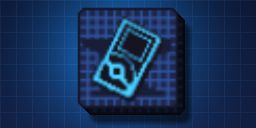
</p>

<h1 align="center">PKForge for Nintendo 3DS</h1>

<p align="center">
  <a href="https://github.com/EnerGonix/PKForge3DS/releases/latest"></a>
  <a href="https://github.com/EnerGonix/PKForge3DS/releases"></a>
  
  <a href="LICENSE"></a>
</p>

<p align="center">
  <a href="#-download-straight-to-your-3ds">Download</a> ·
  <a href="#-r4-pokélink-the-saves-on-your-r4-card-edited-on-the-3ds">R4 PokéLink</a> ·
  <a href="#screenshots">Screenshots</a> ·
  <a href="#features">Features</a> ·
  <a href="#install-and-update">Install</a> ·
  <a href="CHANGELOG.md">Changelog</a> ·
  <a href="#build">Build</a> ·
  <a href="#credits-and-licences">Credits</a>
</p>

A native 3DS homebrew port of [PKForge](https://github.com/sofianeelhor/PKForge), the Pokémon save
editor and Bank for Android. PKForge itself is C# on .NET MAUI and PKHeX.Core, which cannot run on a
3DS, so this port rebuilds its screens in C++ with citro2d and uses
[PKSM-Core](https://github.com/FlagBrew/PKSM-Core) (the engine of PKSM, which PKForge's look comes
from) for reading and writing saves.

**Games covered: Generation 1 to 7, from Red/Blue/Green up to Ultra Sun and Ultra Moon** (Game Boy, Game
Boy Advance, DS and 3DS). Let's Go and the Nintendo Switch games are out of scope.

It opens on a title screen (PKForge's logo over the Android splash colour; touch or A to go on).

## 📲 Download straight to your 3DS

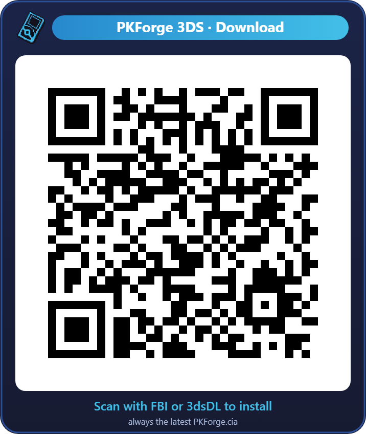

Scan the QR code on the 3DS and it installs the newest `PKForge.cia`, no PC needed:

- **FBI**: Remote Install › Scan QR Code
- **3dsDL** (or any QR CIA installer): scan it the same way

It always points to the latest release:
`https://github.com/EnerGonix/PKForge3DS/releases/latest/download/PKForge.cia`

<br clear="right">

## ⭐ R4 PokéLink: the saves on your R4 card, edited on the 3DS

New in this port. If you play DS, GBA or Game Boy Pokémon games on an **R4 (Ace3DS) flashcart**, their
saves live on the R4's own microSD, out of reach of every 3DS save editor. **R4 PokéLink**
([`r4pokelink/`](r4pokelink)) talks to the R4 straight from the cartridge slot: PKForge's **R4 button**
starts it, it copies the R4's Pokémon saves to the 3DS SD card for PKForge to edit, and writes the edited
saves back to the R4. No PC, no taking the microSD out. Every write to the R4 backs the save up first and
reads it back to check it. Developed and tested on an r4isdhc.hk 2024 card.

## Screenshots

Top and bottom screens, captured in Azahar.

| Home | Boxes | Summary |
|:---:|:---:|:---:|
| 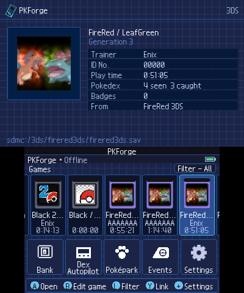 | 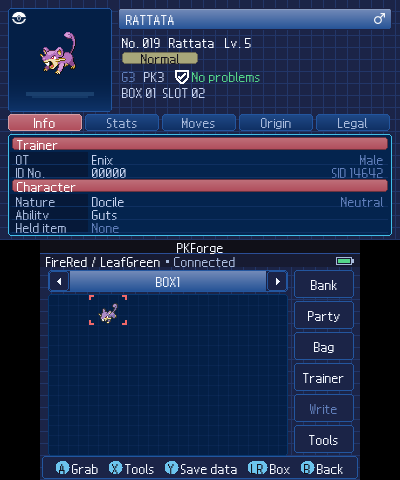 | 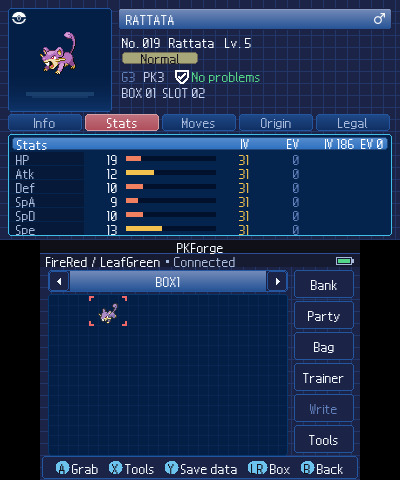 |
| **Editor** | **Bank** | **RNG / IVs** |
| 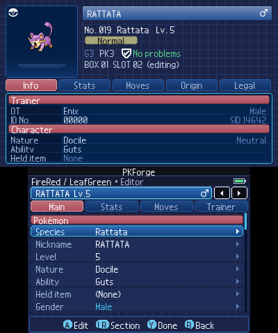 | 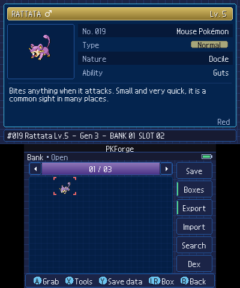 | 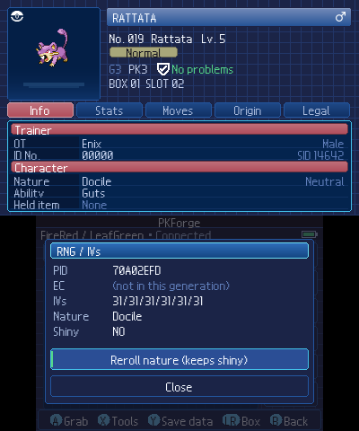 |
| **Dex Autopilot** | **Poképark** | **Color themes** |
| 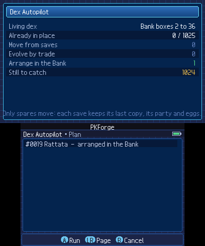 | 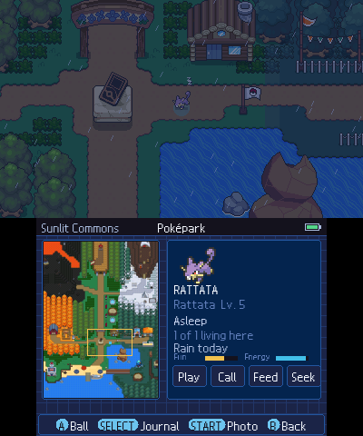 | 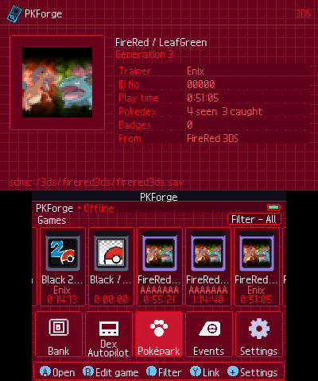 |

The top screen is PKForge's second-screen inspector; the touch screen holds the boxes, editor and menus.

## Features

### 💾 Saves
- **3DS games**: the cartridge in the slot and installed copies of X, Y, Omega Ruby, Alpha Sapphire, Sun,
  Moon, Ultra Sun and Ultra Moon, and the Virtual Console Red, Blue, Yellow, Gold, Silver and Crystal.
  Writing commits the save and clears its secure value, as PKSM and Checkpoint do.
- **DS cartridges** (Diamond to Black 2) in the 3DS slot: the save chip is read and written over SPI, with
  a read-back check after.
- **Saves anywhere on the SD card** (emulators, TWiLight Menu++, Checkpoint and JKSV dumps,
  `sdmc:/3ds/PKForge/saves`), Generation I to VII, shown as cartridge cards.
- **R4 flashcarts** through R4 PokéLink (see above).
- **Every write keeps a restore point first**: the 20 newest per save, in `sdmc:/3ds/PKForge/backups`.
- SELECT on a card deletes that save file, after a restore point. A game's own save data (cartridge or
  installed title) is never deleted.

### 📦 Boxes and Bank
- Grab and drop with A or by dragging with the stylus, L/R for boxes; multi-select to send, move,
  duplicate, export or release in bulk.
- **The Bank**, in PKForge's own layout (`index.json` plus one `.bin` per Pokémon) in
  `sdmc:/3ds/PKForge/bank`. SELECT switches between the save and the Bank. Moves become final when the save
  is written: leaving without writing puts deposits back.
- **Move Pokémon between games** with a transfer preview of every change and the legality verdict.
- **Box manager**: sort by Pokédex, level, IVs, type or date met; lock, copy, swap, rename, wallpapers;
  audit the whole save.
- **Search this save**, Bank search, **Living Dex** (every species and where you have it, over the Bank
  and every save found) and **Dex Autopilot**, which fills a living dex in the Bank from your spares.
- **Day Care / Nursery** (Generations 3 to 7): who is deposited, the EXP gained, whether an egg waits, and
  a withdraw into a free box slot.

### ✏️ Editor
- Species, form, nickname, level, nature, ability, item, gender, shiny, ball, friendship, language, egg,
  Pokérus, IVs, EVs, Hyper Training, moves, PP Ups, relearn moves, trainer and origin, with ‹ › to step
  through a box. Searchable pickers with Pokédex entries and move details on the top screen.
- **RNG / IVs**: reroll a nature keeping shininess. **Hex editor** for a Pokémon's decrypted bytes.
- **Bag editor** with presets, **trainer card** and trainer profiles, box names.
- **HaX mode** (every species, move, item and ball the generation can store) and **Hardcore mode** for
  challenge runs.

### 🧰 Tools
- **Legality**: offline checks and fixes (moves the species line can learn, abilities, items, balls, IV/EV/PP
  limits), and PKHeX's full check through FlagBrew's [local-gpss](https://github.com/FlagBrew/local-gpss)
  on a computer on the same Wi-Fi (START > Legality server).
- **Egg factory**: one egg of every species the game can hatch; **new egg** of any species, built as the
  Day Care makes one.
- **Showdown** sets: export a Pokémon or a box, import sets into the empty slots.
- **QR codes** in the Android PKForge's PKF1 format, read by the outer camera or from a picture.
- Export and import of `.pk1`–`.pk7` files (`sdmc:/3ds/PKForge/export` and `import`), readable by PKForge,
  PKHeX and PKSM.
- **Nuzlocke report** from the box manager.

### 🎁 Events and world
- **Mystery Gift**: PKHeX's database of every real distribution for Generations 4 to 7, searchable, sent
  into the save's gift inbox for the game to hand over.
- **World & events**, on the save's bytes at PKHeX's offsets: Ruby/Sapphire/Emerald clock repair (reset,
  berry fix), the Gen 3 roaming legendary, HeartGold/SoulSilver Apricorn Box and Pokéwalker, Diamond/Pearl/
  Platinum honey trees, key item events (Eon/Aurora/Mystic Tickets, Old Sea Map, Member Card, Oak's Letter,
  Azure Flute, Secret Key, Enigma Stone, GS Ball, Liberty Pass, ORAS's Eon Ticket), Sun/Moon Poké Beans,
  and re-arming Red/Blue/Yellow's one-time encounters.

### 🌳 Poképark
Up to 24 of the Bank's Pokémon living on the Android PKForge's park map, with the light of the hour: they
wander, meet and react, sleep at night, chase the ball you throw, race, play hide and seek, nap at the
Daycare when tired, and the park keeps a journal (`sdmc:/3ds/PKForge/park-journal.txt`).

### 🔊 Sound and look
- Music by place (title, menus, park by day, park by night), soft menu sounds and a cursor tick, a cry for
  each Pokémon. Your own tracks go in `sdmc:/3ds/PKForge/music/{title,menu,park-day,park-night}` (MP3, OGG,
  WAV) and your own cries in `sdmc:/3ds/PKForge/cries/<national number>.wav|ogg|mp3`. Needs Luma's DSP
  firmware dump.
- The original's 19 colour themes, a title screen, a quick guide on the first start, and a **3D HOME Menu
  banner** (the logo as a real 3D model, in stereoscopic 3D) with its own sound.

### 🔄 In-app updates
Settings › Check for updates downloads the newest `PKForge.cia` from this page over verified HTTPS, checks
its SHA-256 against GitHub's and installs it, then restarts. A quiet check runs once a day.

### Not in this port yet
Generate and the encounter browser, Colosseum/XD saves and ROM hacks need parts of PKHeX ported to C++.
Let's Go and the Switch games are out of scope.

## Install and update

1. Install `PKForge.cia` with FBI or 3dsDL (the QR code above, or copy the file to the SD card). PKForge gets
   its own icon on the HOME Menu (title 00040000-0E4F0B00).
2. Needs a 3DS with custom firmware (Luma3DS). For sound, dump the DSP firmware once (Rosalina menu ›
   Miscellaneous options › Dump DSP firmware). For R4 PokéLink, an R4 / Ace3DS card and TWiLight Menu++.
3. To update: Settings › Check for updates, or install a newer CIA over it. Everything PKForge keeps (Bank,
   backups, settings, your music) is in `sdmc:/3ds/PKForge` and stays.

What changed in each version: [CHANGELOG.md](CHANGELOG.md).

## Build

`build.sh` makes the CIA with `tools/ctr/cia.sh` (makerom from Project_CTR, bannertool from
Epicpkmn11). `PKForge.3dsx` is still built, for the tests in Azahar (`tools/run-autotest.ps1`).

The HOME Menu banner is a 3D model the HOME Menu turns and shows in stereoscopic 3D: PKForge's logo with
its cyan lines in relief and a plain blue back. `tools/ctr/make_banner3d.py` writes it as glTF and
[pycgfx](https://github.com/skyfloogle/pycgfx) (by skyfloogle) converts it to `tools/ctr/banner.cgfx`, which
the build uses as it is; the banner sound (a device clacking open, then a ball opening) is synthesized by
`tools/ctr/make_art.py`. Both are original.

devkitPro with `3ds-dev` (devkitARM, libctru, citro2d) and `nds-dev` (for R4 PokéLink), MSYS2 with
Python 3, and the PKForge source tree for its art and fonts. `build.sh` builds R4 PokéLink first and
copies it into `romfs/r4`.

```bash
git clone --recursive https://github.com/FlagBrew/PKSM-Core external/PKSM-Core
PKFORGE_SRC=/c/path/to/PKForge bash build.sh
```

The music is not generated: put MP3s in `romfs/music/{title,menu,park-day,park-night}`. The release uses
Kevin MacLeod's CC BY 4.0 tracks kept in `music-cc/`: `carefree.mp3` for title and menu, `wholesome.mp3`
for park-day, `dreamy_flashback.mp3` for park-night. `tools/ctr/makerom.exe` and `bannertool.exe` are
not in the repository: get them from Project_CTR and Epicpkmn11's bannertool releases.

`tools/assets.py` converts PKForge's resources once into `romfs/` (delete `romfs/.assets-done` to redo
it). `tools/run-autotest.ps1` runs a script from `tests/` in Azahar and saves screenshots; scripts can
only write saves in `sdmc:/3ds/PKForge/saves`. `tests/check_gen3.py` checks a written Gen 3 save
independently (section and Pokémon checksums).

## Credits and licences

- **En3rGonix** ([github.com/EnerGonix](https://github.com/EnerGonix)): PKForge for Nintendo 3DS and R4 PokéLink.
  Source: [github.com/EnerGonix/PKForge3DS](https://github.com/EnerGonix/PKForge3DS).
- PKForge by sofianeelhor, GPLv3 or later. This port is GPLv3 or later as well (see `LICENSE`).
- PKSM-Core by FlagBrew (Bernardo Giordano, Admiral Fish, piepie62 and contributors), GPLv3 with
  Additional Terms 7.b and 7.c, kept unmodified in `external/PKSM-Core`; memecrypto by SciresM;
  pcg-cpp by Melissa O'Neill.
- PKHeX by Kaphotics and contributors: the research behind PKSM-Core.
- AlchemyBats: the tileset the Poképark's map is built on (from the Android PKForge's resources).
- Audio decoding: [dr_mp3 and dr_wav](https://github.com/mackron/dr_libs) by David Reid (public domain /
  MIT-0) and [stb_vorbis](https://github.com/nothings/stb) by Sean Barrett (public domain), in `external/audio`.
  The effects and made-up cries are original to this port.
- Built-in music: "Carefree" (menus), "Wholesome" (park by day) and "Dreamy Flashback" (park by night) by
  Kevin MacLeod (incompetech.com), licensed under Creative Commons: By Attribution 4.0
  (http://creativecommons.org/licenses/by/4.0/); also in `romfs/licenses/music.txt`.
- QR codes: [QR Code generator](https://github.com/nayuki/QR-Code-generator) by Project Nayuki (MIT),
  [quirc](https://github.com/dlbeer/quirc) by Daniel Beer (ISC), and
  [stb_image](https://github.com/nothings/stb) by Sean Barrett (public domain), in `external/`.
- Updates download with [curl](https://curl.se) (curl licence, Copyright Daniel Stenberg and contributors),
  [Mbed TLS](https://github.com/Mbed-TLS/mbedtls) (Apache-2.0) and [zlib](https://zlib.net) (zlib licence),
  the devkitPro portlibs builds; their licence texts ship in the app's `romfs/licenses`.
- DS cartridge saves over SPI: `source/spi.cpp` / `spi.hpp` from Checkpoint (Bernardo Giordano,
  FlagBrew) and TWLSaveTool (TuxSH), GPLv3 with Additional Terms 7.b and 7.c, marked as modified
  (logging removed).
- PKSM's pixel chrome (GPLv3) and spritedmistery's PKForge logo, look and color schemes. PKForge's author
  and the artist of the logo and button images approved their use in this unofficial port
  ([sofianeelhor/PKForge#73](https://github.com/sofianeelhor/PKForge/issues/73)).
- Pokémon Showdown / Smogon sprite artists: front sprites and box icons.
- PokeAPI (BSD-3): move, ability and Pokédex facts.
- game-icons.net (CC-BY 3.0) icons; SteamGridDB community cartridge art.
- NDS12 font by Caveras (CC BY-NC-SA 3.0), shipped with its licence and readme in `romfs/licenses`.

Pokémon and Pokémon character names are trademarks of Nintendo, Creatures Inc. and GAME FREAK inc.
Not affiliated with Nintendo, Game Freak or The Pokémon Company.
